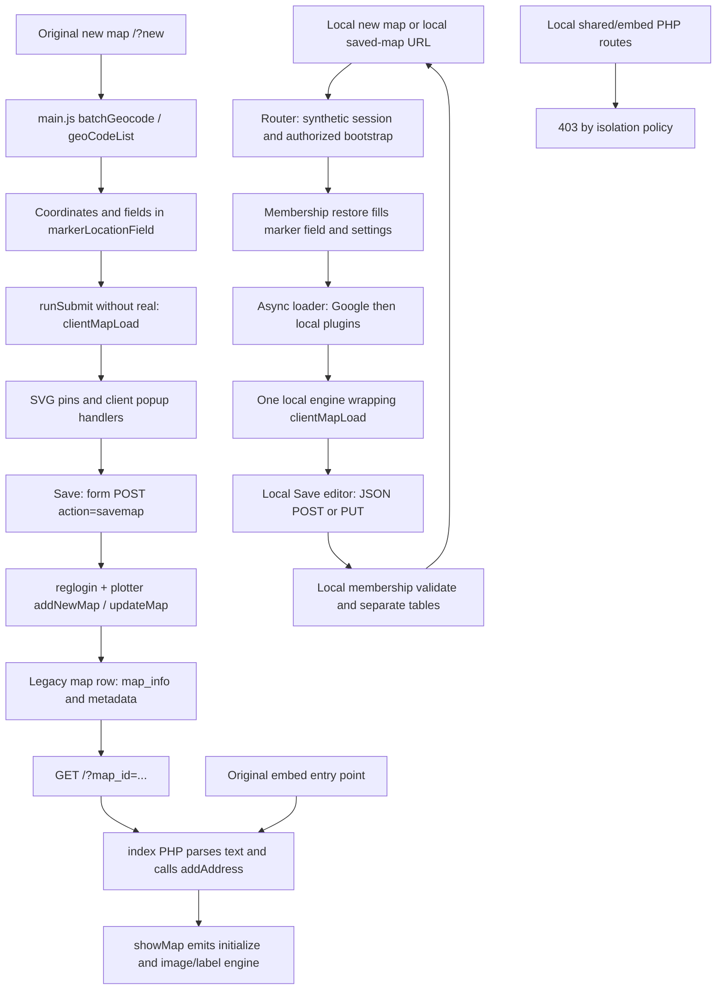

# Multiplottr mapping consistency plan

Implementation update, 2026-10-26: the owner subsequently authorized Phase 0 and Phase 1 locally. The separate workspace and verification are documented in [mapping-dev/README.md](mapping-dev/README.md) and [mapping-dev/RESULTS.md](mapping-dev/RESULTS.md). The original planning text below records the proposal; later phases, production integration, customer migration, deployment and AI/MCP work remain unauthorized.

Prepared 2026-10-25. Planning and investigation only. Architectural changes, feature development, AI/API/MCP work, customer migration, deployment, and production access remain paused. Neither application working tree nor its configuration/isolation was changed.

## Plain-language diagnosis

Corey's observation has a concrete explanation in the imported source: **plotting addresses and opening a saved map select different rendering implementations, even though both use Google Maps JavaScript.** It is not simply a different theme.

New plots run `scripts/main.js::clientMapLoad()`. That creates SVG pins using `google.maps.Marker`, native marker labels, a simpler popup, and its own arrays and click handlers. Saved-map requests load text from the database, pass it through PHP's `MultiplottrMap::addAddress()`, then run a large JavaScript engine emitted by `mpcMain.v7.4.php::showMap()`. That engine uses image icons, `MarkerWithLabel`, different popup editing links, group controls, settings logic, and MarkerManager. Saving a new map submits a form and redirects to `?map_id=...`, crossing this boundary.

This is strongly supported by source and targeted execution of isolated components. It is **not a fresh end-to-end reproduction of the original application or production**: original routes are quarantined locally, and no imported records or production services were used.

The current local app deliberately removed the PHP-generated engine and uses the client renderer for both new and reopened maps. Its synthetic membership service also replaced original saving and access rules. It demonstrates that one renderer can work across the basic lifecycle, but its data model is too narrow to be a compatibility solution: it strips formatted descriptions, rejects advanced marker types, and drops unknown fields. A basic local save/reopen PASS must not be interpreted as original feature parity.

**Recommendation:** keep the preferred client interaction and SVG-pin appearance as the starting point, but incrementally separate its rendering from its global state, DOM text fields, geocoding, and saving. Use one versioned document model and one shared editor/viewer renderer. Port legacy capabilities through explicit adapters and tests rather than switching between two engines or undertaking an immediate wholesale rewrite.

## Evidence labels and scope

- **E-now:** executed during this investigation. Synthetic data only. JavaScript renderer probes use Maps doubles; PHP probes run real PHP 7.4 in the already-running isolated container. No browser, geocoding, HTTP, sessions, or database constructor is involved.
- **E-prior:** existing recorded browser execution, with actual Maps or offline scope stated. These are historical artifacts, not rerun results for this task.
- **S:** supported by static source. Presence of a branch does not prove a complete working feature.
- **U:** unresolved or not executed. Production routing, membership/access behavior, and actual customer schema/content remain unresolved.

References below use working-source paths and function names. The separate review copies in `preservation/original-source/` and `preservation/local-test-source/` identify the baseline source families; their credential redactions make them review copies, not deployable code. See [BASELINE-PRESERVATION.md](BASELINE-PRESERVATION.md).

### Targeted checks performed

Command: `node local-test/mapping-consistency-probes.cjs`

Results: [mapping-consistency-probe-results.json](local-test/mapping-consistency-probe-results.json). The script and generated results are local investigation artifacts, ignored by Git with the rest of the working harness. No temporary accounts, maps, or other database records were created, so none needed cleanup.

| Probe | Execution finding |
| --- | --- |
| Original and local `clientMapLoad()` with four synthetic marker records | Both construct SVG pins, a `NUMBER` label of `1`, and a smaller `SMALLBLUE` pin. Both pass a custom-image URL as SVG `fillColor`, rather than using it as an image icon. This proves constructor choices with doubles, not actual Google rendering of the invalid color. |
| Three calls to each client renderer | Original retains three map-click listeners; local retains one. Both reuse the map object in this probe. This does not test every DOM handler, manager registration, or full startup path. |
| Actual local `LocalMembership::validate()` using Reflection without its constructor | HTML is stripped, `NUMBER` is rejected, marker IDs/original addresses and geometry/extensions are dropped, and map type is forced to road map. The supported normalized subset remains stable on a second validation pass. This does not exercise endpoint persistence. |
| Sanitized original PHP `addAddress()` and `showMap()`, coordinates only | `NUMBER` is accepted. `NUMBRED` falls back to `RED`, empty description, and `group0`. Generated output contains the different image/MarkerWithLabel engine and saved-route onload binding. Only the coordinate path was executed; no old server geocoding branch was invoked. |

All four probe assertions passed. Several assertions intentionally confirm undesirable behavior; they are not feature acceptance passes. Early probe attempts needed missing readiness/bounds test doubles added to the probe, with no application changes.

Prior evidence: [maps-live-results.json](local-test/maps-live-results.json) covers real rendering, two-address plotting, invalid address, placement, settings, and print CSS; [maps-native-print-results.json](local-test/maps-native-print-results.json) records visually verified native desktop preview; [membership-results.json](local-test/membership-results.json) covers real Google rendering with synthetic local accounts and PHP/MariaDB save/reopen/edit/delete/ownership tests. [membership-offline-results.json](local-test/membership-offline-results.json) covers persistence without Google. These establish a tested subset, not broad legacy parity. Native preview DOM automation was inconclusive; its PASS was visual. No new browser suite or external Maps requests were run here.

## Current workflow diagram

The original embed page has its own template and parsing before calling the same PHP renderer family; the diagram combines those parsing stages for readability. Local data restoration can run before Maps is ready; settings are reapplied on the `local-maps-ready` event.

## Trace of the original snapshot

The strongest candidate source family is root `index.php` → PHP 7.4 classes. Parallel `index*`, `mpcMain*`, and embed variants exist; the deployed choice cannot be confirmed locally. Nothing here assumes the newest filename is deployed.

| Action | Files, functions, endpoints, and format | Consequence / evidence |
| --- | --- | --- |
| Start new map | `scripts/main.js` window-load handler checks `?new` and calls `clientMapLoad()`. `#clearYes` clears fields, calls `runSubmit('dontLook')`, navigates to `/?new`, and also calls the client renderer. Root `index.php` builds the page and calls PHP `showMap()` even though the saved-route initializer is not selected. | S: page contains overlapping engine definitions. Reset includes rendering and navigation, rather than a single document transition. |
| Plot multiple addresses | `batchGeocode()` → `timedGeocoding()` → `geoCodeList()` → browser Geocoder. `geoCodeList()` stores ordered `~lat,lng|description|markerType|group` records in `#markerLocationField`; `runSubmit()` without `'real'` calls `clientMapLoad()`. Original successful geocoding also calls `admin/process_log.php`. | S: original address is not a dedicated persisted field; information can survive only if included in description or elsewhere. Logging is disabled/quarantined in the local harness. Mixed-result batch correctness is U. |
| Place and edit markers | `main.js` click/selection handlers and `#newMapSubmitMarker` append coordinate records, then rerender. `clientMapLoad()` builds SVG pins and InfoBox content. PHP-generated functions include `placeMarker`, `editPlacedMarker`, `editValues`, `deleteValues`, and drag behavior for its edit preview. | S/E-now: different code paths and popup actions. The client-rendered popup's edit/delete links are commented out/empty, while generated `createMarker()` includes them when `allowEdit` is true. Complete marker-edit UX across engines is U. |
| Save new map | `#saveMapButton` populates hidden metadata, sets `action=savemap`, then `runSubmit('real')` submits `#mapTool` to its configured action. `reglogin.v7.4.php` dispatches to `plotter::addNewMap()`, then redirects to `?map_id=...`. | S: text marker records become `map.map_info`; title/description, identity, profile/show flags, date and link are separate columns. Not a structured versioned document. |
| Open saved map | `index.php` calls `getMapBasicInfo(map_id)`, normalizes CRLF to backticks with `nl2brStrict()`, splits rows and four pipe fields, calls `MultiplottrMap::addAddress()`, and emits ready handlers to repopulate the textarea. `showMap()` emits `initialize()` and binds `window.onload = initialize` for `?map_id`. | S/E-now: saved view changes to the image/MarkerWithLabel renderer. PHP generates executable JS and values; Google still renders in the browser. It is not a static/server-rendered map image. |
| Edit and resave | Generated popup editing updates field text and markers; save follows the same form dispatch. Existing-map save checks owner/admin, then `updateMap()`; “newmap” option calls `addNewMap()`. | S: identity and text-field state are spread across PHP, JS, hidden inputs and browser storage. Full repeated-cycle preservation remains U. |
| Share and embed | Share URL points to `/?map_id=...`; `main.js` generates iframe URLs for `index_embed.php?map_id=...`. `index_embed.php` loads the PHP 7.4 classes, parses saved fields, selects edit display based on username comparison, and calls `showMap()`. Other embed variants exist. | S: a shared normal URL uses the saved-map family; embed uses a separate template with the generated renderer. U: actual public/private access, iframe constraints, and deployed variant. |

### Important original details

- `main.js::clientMapLoad()` uses a fixed SVG path, scale changes for `SMALL*`, and a prefix check `NUMB` that also matches `NUMBER`. Number labels follow array order; marker IDs are counters reset on each render. Its custom-image picker does not make this renderer use image icons. **E-now/S**.
- `mpcMain.v7.4.php::addAddress()` recognizes an explicit type mapping and HTTP icon URLs. `NUMBER` selects numbered image assets in generated output; `createMarker()` uses `MarkerWithLabel` and can derive a label from `<h1>` content. `CENTER`, `RADIUS`, and LINE branches encode camera/geometry semantics in records that otherwise resemble markers. Polygon/other type names exist without complete parity proof. **S**, with the specific NUMBER/fallback behavior **E-now**.
- Generated `hideGroup()`, `checkGroupNames()`, `hideAll()/showAll()`, group arrays, and popup edit links are not equivalent to merely retaining a group name in client records. **S**.
- `showMap()` defines one `initialize`; `main.js`, loaded later in root `index.php`, defines another empty `initialize`. The saved route binds a function reference to `window.onload` before the later global name is replaced; the later replacement does not by itself erase that captured callback. Other calls by global name can resolve differently. Treat this as fragile lifecycle coupling, not a claim that the captured callback cannot run. **S**.
- `showMap()` emits settings/control options and KML accumulation. `index.php` reads query settings; `getMapsListingsModule()` adds stored `map_link` attributes to My Maps URLs. The inspected save handler sets its `$mapLink` argument to an empty string, despite the browser posting `mapUrlParam`; `updateMap()` does not update `map_link`. Some camera state is also represented by CENTER rows. A single authoritative settings round trip is not established. **S/U**.
- `nl2brStrict()` specifically converts CRLF sequences, whereas other paths split LF or backticks; saved text is also escaped, deduplicated with `array_unique`, and split on bare pipes. Repeated serialization can therefore behave differently for delimiters, duplicate rows, HTML entities and line endings. These are supported risks, not a claim that all existing maps are corrupt. **S/U**.
- `getMapBasicInfo()` selects by map ID without an ownership predicate; creation writes a `private` profile value, while mutation handlers have owner/admin checks and edit visibility uses a username comparison. Neither the profile string nor the read query alone establishes the intended effective production sharing policy. **S/U**. Preserve established permissions once verified; do not infer public or private defaults.
- Non-coordinate `addAddress()` contains older server-side geocoding/fallback paths. They were not invoked. A compatibility loader should use saved coordinates, not silently re-geocode locations or re-enable server internet. **S**.

## Trace of the current local implementation

1. **Request/authorization:** `local-test/router.php` allows canonical GET `/`/`index.php`, accepts only `map_id`/`new`, and loads `LocalMembership::readMap()` for a saved ID. It removes `map_id` from PHP's query data before invoking the legacy page, preventing imported-map lookup. The browser URL remains a saved-map URL. It injects escaped `local-membership-bootstrap` JSON. Legacy writes and noncanonical PHP routes are rejected. **S; E-prior ownership tests**.
2. **Initialization:** local `mpcMain.v7.4.php::showMap()` emits only the canvas. `local-maps-loader.js::startDevelopmentMaps()` uses a boot promise, private config endpoint, fixed Google loader, then ordered InfoBox → MarkerWithLabel → geolocation helper → pinned MarkerManager → jQuery UI Map → local engine. Offline mode avoids Google. No switch/config change was made in this investigation. **S; E-prior live/offline tests**.
3. **Render and restore:** `local-membership.js::restore()` translates JSON markers back to newline pipe records, encoding description/group as `@local:` percent-encoded fields. `clientMapLoad()` decodes them. `local-map-engine.js::initialize()` wraps that renderer to refresh legend/manager and applies local restrictions. `restore()` fills data at DOM ready; `applySettings()` runs both then and on `local-maps-ready`. New and saved local maps therefore share the same SVG renderer. **S; E-prior real lifecycle**.
4. **Plot/place:** local `main.js` retains the client workflow with readiness guards, invalid-address feedback, listener cleanup and preview fixes. New plot and new placement eventually modify the same text field. Groups are carried as text; complete group filtering is not reintroduced by this. **S/E-prior**, listener result **E-now**.
5. **Save/resave:** a capturing listener intercepts Save/My Maps. `openSave()` uses `markersFromField()`/`settingsFromMap()` and opens a separate synthetic editor. Submit sends JSON to POST `/__local_membership/maps` or PUT `/__local_membership/maps/{id}`. `LocalMembership::validate()` whitelists fields, and prepared SQL stores the normalized payload in separate `local_membership_maps` rows. Response `restore()` rerenders immediately and replaces the URL. No schema version, persistent per-marker ID, or optimistic save revision exists. **S/E-prior**.
6. **Open/delete:** My Maps uses GET list results and `/?map_id={local-id}` links. API read/update/delete use session-derived ownership. Record IDs are random hexadecimal values, distinct from the original numeric IDs. Delete goes through the local API; New Map clears local current state on confirmation. Shared/embed PHP routes remain 403. **S/E-prior**.

### Local loss boundaries verified now

The validator rebuilds only title, plain-text description, markers `{lat,lng,description,group,color}`, and settings `{center,zoom,minZoom,maxZoom,zoomControl,mapTypeControl,legendVisible,mapTypeId:'roadmap'}`. Unknown fields are not round-tripped. Rich HTML is decoded/stripped; NUMBER/SMALL/custom icon types are rejected. Synthetic added IDs, original addresses, geometry, and extensions were discarded in the probe. This service must **not** be used as a legacy migration writer under the agreed preservation rule.

`settingsFromMap()` uses current saved legend state rather than directly reading every UI change; stored title/description can also remain authoritative when reopening the separate save editor. These are static state-divergence risks requiring focused UX tests, not newly reproduced browser failures. The proposed document store removes this competing-state problem.

## Evidence-backed comparison

“Original saved” includes the normal shared-map URL. “Embed” has a separate template. Local new/reopened use the same renderer but not original authentication or serialization.

| Dimension | Original new map | Original reopened map | Original shared/embed | Current local new ↔ reopened |
| --- | --- | --- | --- | --- |
| Rendering/initialization | SVG client renderer; `main.js::runSubmit/clientMapLoad`, `?new` load handler. **S/E-now doubles** | `index.php` parse → `addAddress` → emitted `initialize/createMarker`; image/label engine. **S/E-now PHP output** | Normal share follows saved path; embed calls `showMap` from `index_embed.php`. **S**, actual embedding **U** | Async loader + canvas-only PHP + shared client renderer. **S/E-prior real Maps** |
| Styles/labels/numbering/icons | SVG, SMALL scale, NUMB-prefix native label; custom URL incorrectly occupies fillColor. **E-now doubles/S** | Image icons, NUMBER image sequence, MarkerWithLabel/H1 labels, HTTP image branch. NUMBER accepted; unsupported NUMBRED falls back and clears fields. **S/E-now PHP subset** | Same renderer family with template/query differences. **S/U** | Same SVG appearance on supported records. Advanced types rejected by local persistence. **E-prior basic/E-now validator** |
| Descriptions/media | Client popup concatenates description HTML; TinyMCE input. Full media safety/behavior **U/S** | Generated popup adds different actions and extracts H1 labels/legend text. **S**, full media round trip **U** | Same rich-content source paths; effective safe/public output **U** | Input can be rich, save strips HTML; plain text stable. **E-now**, prior real text round trips |
| Groups/visibility | Field group retained; complete filtering not established. **S/U** | Generated grouping, hide/show, group indices and controls. **S**, full execution **U** | Generated grouping; view permissions unresolved. **S/U** | Names persist; complete visibility/order/filter parity **U**. **E-prior names** |
| Camera/zoom/types/controls | New map starts at world/zoom 2, fits bounds; flags/global state. **S** | PHP/query/control settings plus CENTER-record camera semantics and fit/manager logic. **S** | URL attributes/template settings may alter view. **S/U** | Road-map only; restore reapplies saved camera/options after rendering. **E-prior real Maps**; alternate types **U** |
| Editing/deletion | Client placement exists; popup edit/delete controls absent/commented. Repeated map click listeners accumulate. **S/E-now listeners** | Conditional popup edit/delete, generated editing previews/drag; owner/admin mutation dispatch. **S**, entire workflow **U** | `showEdit` toggled by username comparison; must not equate UI hiding with authorization. **S/U** | Separate local save editor handles field/marker edits; one map-click listener in probe. Own-map update/delete and cross-user denial passed. **E-prior/E-now** |
| Serialization/save | Text field → form POST; metadata in hidden fields; storage caches. **S** | Text `map_info` parsed/escaped/deduplicated; resave same form dispatch; no explicit schema/revision. **S** | Read same record family; no separate proven share-grant model. **S/U** | JSON payload ↔ encoded textarea bridge; whitelisted subset only, no version/location IDs/save revision. **S/E-now/E-prior subset** |
| Permissions | WordPress/legacy session bridges and client tier flags. **S/U** | Read query, edit visibility, owner/admin writes are different layers; effective production policy **U** | Profile fields are not enough to infer access. Actual grants/anonymous behavior **U** | Session-owner-only synthetic store with CSRF/Origin protections. **E-prior**, no WordPress parity |
| Printing/export | Shared print CSS/UI, but PHP-generated KML state may not track fresh client render. **S/U** | Generated `kmlmsg` populates hidden field; download endpoint returns supplied content. Real round-trip KML **U** | Template/view/export compatibility **U** | Three-marker real native print preview visually passed earlier. Large/private edited-map print unverified. KML/legacy embeds blocked by design. **E-prior/S/U** |
| Loading/errors/empty | Global browser caches/progress and geocoder callbacks; original ZERO_RESULTS handling has gaps. **S/U** | Reload plus PHP parse, optional server geocoding and generated load handlers; no unified document state. **S** | Missing/unauthorized/error response semantics **U** | Loader failure isolated from menus; input preserved; invalid real address handled. Empty/private access errors are local-only. Interrupted saves/conflicts **U**. **E-prior/S** |

## Recommended target architecture

### One document, one rendering lifecycle

Use a pure, versioned **MapDocument** independent of Google objects and HTML scripts. All workflows follow the same sequence:

1. Resolve route/identity and authorize access on the server.
2. Obtain a new empty document, an authorized stored document, or a compatibility-adapted legacy document.
3. Validate and normalize without discarding unknown content; produce explicit capability/compatibility findings.
4. Mount one renderer once; apply document/settings and register each interaction once.
5. Route editor commands into the document store; rerender affected components using stable IDs.
6. Save a plain document with expected revision; apply the server's authoritative response to the same store. Loading data must never require executing stored JavaScript.

Editor and viewer share marker/geometry rendering, popup content, groups, legend, camera, print, and export projections. Mode changes commands and controls, not the renderer. Server-provided permissions independently authorize read/edit/delete/share; hiding buttons is not security. Embed is a viewer shell using the same components, with verified access and framing policy.

Lifecycle states should distinguish empty draft, loading data, loading provider, ready, partial geocode results, unsupported legacy content, save pending, save failed, conflict, access denied, not found, and provider failure. Preserve the last good document and unsaved changes through failures. Cancel obsolete loads and ignore stale callbacks using document/load generations. `dispose()` owns listener cleanup; repeated mount/load cannot duplicate events.

### Proposed document contract for design review

| Field/domain | Required meaning |
| --- | --- |
| Identity/version | `schemaVersion`, stable map ID, legacy identity/aliases, server revision, title/description, timestamps. Draft identity separate from persisted identity; the server controls ownership/access metadata. |
| Locations | Stable location ID and order; display name; original submitted address; optional geocoded/formatted address and permitted provenance/status; explicit numeric coordinates with coordinate convention. A map click may have no address. Keep coordinates authoritative on reopen; do not re-geocode automatically. Review provider storage requirements before choosing geocoder metadata retention. |
| Appearance | Explicit kind/color/size/icon reference/anchor, numbering strategy and any manual number, label text/visibility/style. Preserve raw legacy marker token and asset reference alongside its interpreted representation. Stable IDs do not depend on position or numbering. |
| Description/media | Typed plain/rich representation, original recoverable content, sanitized display projection, link/media references, and compatibility warnings. Scripts/unsafe media must not execute; preserve their recoverable original rather than silently removing the only copy. Rich content policy requires owner/security decisions. |
| Groups | Stable group IDs, names, order, visibility, and location memberships. Clarify single versus multiple group membership before changing legacy semantics. |
| Geometry | Explicit features/IDs and ordering; line/polygon coordinates, style, circle center/radius in a declared unit. Keep unrecognized legacy geometry records intact and visibly unsupported until interpreted and tested. |
| Settings | Saved camera center/zoom, fit policy, map type/provider/style references, min/max zoom, control visibility, labels, legend, group visibility, and print options where genuinely persisted. Distinguish transient view changes from authored settings. |
| Compatibility | Adapter version, raw original reference/checksum, original link/query metadata, unknown fields/extensions, conversion warnings, supported/editable capability flags. Do not put private raw payloads into public viewer responses. |

This is a proposed model, not implemented schema or an API contract. Define coordinate order explicitly at adapters: existing text is latitude/longitude, while GeoJSON-like geometry uses longitude/latitude. Do not silently swap them. Stable IDs for legacy locations should be assigned once and persisted in a sidecar/mapping, preserving duplicate occurrences and order; do not regenerate them solely from coordinates or description.

### Client boundaries

- **Document store and commands:** create/update/remove location, change appearance/content/group/settings, manage geometry, undoable draft edits. Never use a textarea or Google Marker as the authoritative document.
- **Renderer/provider adapter:** maps document IDs to runtime objects, applies diffs, owns listeners/popups and disposal. Preserve the preferred SVG visual language where supported. Keep provider objects out of serialization.
- **Geocoding service adapter:** tracks each request/result against a stable draft location, original input and generation. Mixed success, zero results, ambiguity, retries and cancellation are explicit; late callbacks cannot modify another map. Deduplication suggestions must not remove intentional duplicate locations.
- **Content/appearance adapters:** shared popup/legend/print projections and asset validation. Unknown styles produce a visible warning/read-only boundary, not a silent red replacement.
- **Persistence adapter:** authorized load/save, canonical response, revision checking, draft preservation on error, conflict handling. Viewer cannot invoke mutation commands, and server rejects them regardless.
- **Compatibility adapter:** parses supported legacy variants as data; never evaluates emitted JS or fetches arbitrary file/data URLs. Reports unresolved rows/fields and retains their originals.

### Server boundaries and validation

Server handlers should resolve the real account/entitlements, authorize the requested operation, validate documents and revisions, and return/store data. Production authentication must integrate with the verified WordPress/session system; the synthetic local membership remains a test adapter only. Machine authentication is a separate future design.

Define one validation specification with shared fixtures for client/server: IDs, finite coordinates, text/size limits, schema and capabilities, settings ranges, group references, geometry, URL schemes and rich-content policy. Client validation assists editing; server validation is authoritative. Preserve unknown extensions or reject the entire unsupported write with a useful error; do not rebuild a narrowed document and silently drop fields as the local validator currently does. Limits must be agreed against real legacy requirements, not inherited from synthetic test limits.

Use optimistic concurrency: return a revision/ETag; save/delete require the expected revision, atomically checked on the server. A stale save returns an explicit conflict and retains the draft, with reload/compare/save-copy choices. Reserve duplicate-submit handling and retry identity for persistence so a retry cannot create multiple maps. This is ordinary consistency work, not the future bulk API.

### Modernize incrementally, with a bounded replacement option

The preferred renderer is a useful interaction/appearance baseline, but **not a complete modern engine**. It still depends on global state, jQuery 1.8.3 and `.live` handlers, legacy TinyMCE/InfoBox, deprecated Marker, text serialization, and partially mismatched icon support. Local initialization also loads MarkerWithLabel, geolocation, jQuery UI Map and MarkerManager even where the simple path may not need every plugin. Remove a dependency only after mapping actual usage and testing its supported features.

Start by extracting a facade and document-driven commands around the client path, with appearance and parity tests. Migrate popup/event/state logic out of the large script in small steps; keep PHP as an authorized data boundary. Replace the deprecated marker backend behind a provider adapter only after a technical spike verifies labels, numbered/custom icons, raster/vector behavior, accessibility, print, map-ID/key prerequisites, and provider policy against then-current official documentation. Do not tie that change to a new design or silently enable new Google services.

Prefer replacing a bounded component when its legacy plugin cannot meet security, accessibility or compatibility criteria. A complete application rewrite would require rebuilding the less visible saved-map/group/geometry/export/membership behavior and carries substantially greater compatibility risk. Revisit that decision if the adapter spike cannot represent required capabilities reliably; do not assume that reusing every legacy function is cheaper either.

The document/command/authorization boundaries could later let a separately authenticated AI client submit validated location commands, receive per-location results, and safely retry while using the same rendering/persistence rules. No bulk endpoint, machine credential, public MCP server, or AI behavior is part of this plan's first milestone.

## Preservation and compatibility rules

1. **Inventory before conversion.** A separately authorized, sanitized inventory should describe table/column types, field lengths/encodings, source/schema variants, map type tokens, geometry encodings, settings/query attributes, relative/custom asset patterns, HTML/media categories, duplicate rows, and malformed records. Start with schema/counts and synthetic representative cases; do not export customer content into reports. Actual record inspection or migration needs separate authorization and protected handling.
2. **Verify access independently.** Establish effective anonymous/member/owner/admin/share/embed behavior and entitlement rules, including expired subscriptions. `map_profile`, `map_show`, and local owner-only behavior are not a substitute for this verification. Maintain verified behavior without widening access; flag disputed/unsafe behavior for an explicit decision before enabling the new path.
3. **Keep immutable recoverable originals.** Retain original raw records, metadata, URLs and required assets privately with checksums and a reversible link to any adapted document. Maintain per-record conversion reports and adapter versions. Never replace raw content with a sanitized rendering projection. Do not use the current local validator as the migration writer.
4. **Read compatibility first.** Resolve legacy numeric IDs and known embed routes to the same authorized document/rendering components. Preserve parameter meaning where feasible; do not blindly replay arbitrary URLs, executable fragments or file paths. Unknown variants remain unchanged/read-only with a clear compatibility message.
5. **Explicit write gate.** Allow editing only when all affected content can be retained through save. Otherwise preserve and display safely, disable destructive writes, and offer an owner-approved recovery/legacy path. “Save a copy” is not permission to discard hidden geometry or media. Do not dual-write legacy formats without a proven lossless writer and revision strategy.
6. **Verify before cutover.** Compare canonical documents, supported appearance/behavior, old/new URLs, permissions, exports and assets. Legacy fallback requires its own security approval; it must not re-enable quarantined routes or server internet locally. Keep data-format rollback distinct from switching the renderer flag.

Existing URLs and embeds should remain resolvable where technically possible. Public routes must not leak preserved raw content, private notes, owner metadata, or hidden access tokens. Where old embedding/media/security behavior cannot safely continue, report the incompatibility and obtain a decision; do not quietly change the record or its visibility.

## Incremental implementation plan

No phase below is authorized by this planning task. Each phase has a review gate; stop on unsupported content rather than bypassing preservation rules.

### Phase 0 — Contract and compatibility fixtures

- **User-visible outcome:** no behavior change; agreed expectations for “same map after reopen” and an explicit list of unsupported cases.
- **Code areas:** test fixtures and specifications around original `main.js`, PHP parser/classes, local validator, URL/embed handlers. No customer migration or production modification.
- **Dependencies/decisions:** approve required appearance/media/group/geometry/settings semantics; resolve permissions through separately authorized evidence; agree schema/version rules and synthetic cases. See owner decisions below.
- **Acceptance:** executable synthetic corpus includes basic/numbered/small/custom/label markers; rich descriptions/media references; delimiters/Unicode/line endings; duplicate locations; group visibility; CENTER, line/polygon/radius and unknown tokens; settings and legacy URLs. Every record either has an explicit supported representation or a recoverable read-only outcome. Baseline rendering artifacts distinguish real provider tests from doubles.
- **Compatibility:** compare original-parser interpretation with adapter expectations; preserve the raw record and unmapped fields. Pin evidence to a source revision.
- **Rollback:** documentation/test-only change set can be removed without touching either working tree or data.

### Phase 1 — First implementation milestone: one complete local vertical slice

- **User-visible outcome:** create → plot multiple addresses → customize → save → reopen → edit → resave uses the same marker appearance, popup/editor interactions, groups and supported settings. Saving does not change engines or silently narrow the document.
- **Code areas:** a document store/schema/codec and renderer facade extracted from local `app/scripts/main.js`; `local-map-engine.js`, `local-maps-loader.js`, local membership UI and test-only persistence adapter. Prototype validation/compatibility modules live separately from the preserved baseline. No production WordPress change.
- **Dependencies/decisions:** Phase 0 fixture contract. Basic SVG pins and explicitly required marker variants must have document representations. Rich descriptions, groups, geometry and unknown content must either round-trip intact with supported rendering or enter a visible read-only/write-blocked state; no stripping is acceptable. Keep synthetic auth, existing key/CSP scope and network restrictions.
- **Acceptance:** run the entire vertical slice with stable map/location IDs and revision checks. New and reopened documents produce equivalent marker styles/labels/popups/group state/camera/control settings. Repeated saves preserve all fields, ordering, intentional duplicates, Unicode and rich content; supported geometry remains intact. Unsupported fixtures cannot be destructively saved. Distinct new drafts never overwrite the previously opened map. Failed/stale saves preserve drafts and do not create duplicate records. A reviewer can compare new/saved views side by side.
- **Compatibility:** synthetic legacy records pass through a read-only adapter to this same renderer or explicitly report unsupported content. Real WordPress, anonymous sharing, existing customer records and deployed URLs are not certified by this milestone. Plugin/marker backend replacement is included only if needed for the approved slice and separately validated.
- **Rollback:** separate development source set/branch, local feature selection and separate synthetic store/schema. Preserve the current local app/source snapshots. Switch back to the prior local renderer/persistence together; keep any test documents recoverable. No in-place conversion of imported tables.

### Phase 2 — Full required feature and format parity

- **User-visible outcome:** approved numbered/small/custom markers and labels, rich descriptions/media, group visibility, geometry, map types/settings, print and export remain consistent after reopen.
- **Code areas:** shared appearance/content/group/geometry components, document validators, provider adapter, print/export projections, legacy-format adapter. Replace legacy plugins selectively.
- **Dependencies/decisions:** required feature inventory, safe rich-content/asset policy, map type requirements, export formats/coordinate conventions, provider technical spike. Any broader browser permissions/services require separate approval.
- **Acceptance:** each retained capability has create/open/edit/save tests and repeated-cycle equivalence. Unsupported variants remain recoverable and write-blocked. Print and export derive from the document, not hidden stale KML globals; exports are independently parsed and compared. Test round trips only where an actual importer exists; otherwise verify export semantics directly.
- **Compatibility:** compare legacy tokens/assets/settings against approved golden fixtures. Test large maps/legends and custom-media failure states under existing CSP; no silent external fallbacks.
- **Rollback:** component-by-component feature selection; retain prior renderer and original documents. Do not write fields that the rollback reader cannot preserve; keep versioned readers or block rollback writes.

### Phase 3 — Real identity, sharing and legacy route compatibility

- **User-visible outcome:** existing users and allowed viewers open their maps through established URLs/embeds with one rendering experience and the verified access rules.
- **Code areas:** production-boundary authorization adapter, data endpoints, legacy ID/query/embed route resolver and viewer shell. Local tests continue through synthetic identity adapters, not simulated production cookies.
- **Dependencies/decisions:** separately authorized schema and deployed-routing inventory; verified WordPress/entitlement/share model; explicit access matrix; HTTPS/session/iframe policy. No production connections are implied by this plan.
- **Acceptance:** owner/member/anonymous/admin/share viewers receive only permitted documents/actions; direct requests enforce the same rules. Embed cannot escalate to editor; revocation/expiry behavior matches the approved model. Legacy URLs and supported query parameters resolve without losing settings or widening access. Read/edit failures have clear nonleaking states.
- **Compatibility:** test effective access for original and adapted IDs, shared versus private cases without inferring defaults, existing embed dimensions and controls, unauthorized mutations, CSRF and session lifecycle.
- **Rollback:** route/renderer selection can revert independently of auth-policy changes; retain original IDs, raw records and access metadata. Never roll back to an authorization defect merely to restore appearance. Approve a safe fallback first.

### Phase 4 — Verified rollout and retirement, only after separate authorization

- **User-visible outcome:** one consistent experience becomes the approved default without lost maps, content, links or permissions.
- **Code areas:** optional conversion tooling/sidecars, operational checks, versioned persistence and route selection; later retirement of duplicate PHP-generated engine.
- **Dependencies/decisions:** explicit migration/deployment approval, recoverable private backups, complete required acceptance matrix, inventory coverage, conflict/rollback operations and monitoring policy. None are executed now.
- **Acceptance:** every converted record has checksum/provenance, reconciliation results, supported content and URL/access validation, or remains safely unconverted. No unresolved destructive conversion is accepted. Canary comparison and restore rehearsal precede broader cutover. Retire duplicate engines only after verified coverage.
- **Compatibility:** repeat preservation/render/permissions/URL/export tests against authorized representative data in staging; do not publish customer data in artifacts.
- **Rollback:** stop new writes/conversions, restore route selection and compatible reader, reconcile any newer revisions from retained journal/sidecars, verify permissions and content, and resume only after review. A renderer flag alone cannot roll back an incompatible data write.

## Acceptance test matrix for the implementation milestones

| Concern | Required checks |
| --- | --- |
| No content loss | Multiple save/load cycles with canonical field comparisons; preserve unknown extensions, HTML originals, IDs/order, intentional duplicates, image/media references and geometry. Normalize only explicitly agreed fields. Check LF/CRLF/backticks/pipes, Unicode and malformed legacy rows. |
| Equivalent rendering | Feed the same document to draft, persisted editor and authorized viewer/embed. Compare marker shapes/colors/sizes/numbering/labels/icons, popup content/actions, groups, geometry, camera and controls. Real Maps browser checks supplement deterministic adapter tests; readiness alone is not PASS. |
| Geocoding/loading | Mixed valid/invalid/ambiguous results, rate limits, timeout, out-of-order completion, cancel/navigation, retries and late callbacks; no lost existing markers or unsaved content. Use synthetic addresses/fixtures; separately label any real public test geocoding. |
| Initialization/events | Repeated open/close/load, ready/failure/retry, offline mode and document switching; assert one map instance per mounted view, one active interaction handler, disposed markers/listeners and no stale manager registrations. |
| Save reliability | Interrupted/offline request, server failure, duplicate submit, retry after unknown response, concurrent tabs/users, stale revision and delete conflicts; no duplicate maps, silent last-writer overwrite or lost draft. |
| Access | Direct read/update/delete plus UI for each approved role/share state; origin/CSRF/session tests, ID manipulation, embed/read-only enforcement, private response/cache isolation and share revocation. Local synthetic tests are not production WordPress certification. |
| Mobile/keyboard | Small screens, touch placement/selection, keyboard access to every marker via an accessible list, visible focus, popup/dialog focus management, usable settings and error announcements; avoid relying on pointer-only map clicks. |
| Print/export | Real native preview and CSS checks with map tiles/geometry, labels and large legends; expected paper/page layout. Independently parse exports; verify names/content/styles/groups/coordinates according to format limits and explicit warnings. No stale hidden-form export state. |
| URLs/embeds | Authorized legacy numeric IDs, new identities and aliases, settings parameters, embed sizes, missing/denied/deleted records, allowed framing, no external redirect leakage. Unsupported variants have visible recovery paths. |
| Isolation | Offline menus remain usable; Maps uses only the authorized development configuration and scoped CSP. Server internet, production navigation/data connections, real email, payments, ads and analytics remain blocked. Never log keys or customer content. |

## Risks, unknowns and owner decisions

1. **Essential preservation scope:** confirm which marker styles, labels, descriptions/media, group controls, geometry, map settings and export formats must remain editable. The agreed rule preserves their original content even before full rendering/edit support exists; deferral cannot mean stripping.
2. **Preferred interaction:** confirm SVG pins/client plotting as the visual baseline, while retaining useful saved-map popup edit/delete, group and viewer behavior. One renderer must combine required capabilities, not simply delete the older engine's features.
3. **Access policy:** actual anonymous/shared/embed/private and entitlement behavior is unresolved. Original `private` metadata and synthetic owner-only rules do not settle it. Identify authoritative WordPress/session and sharing rules before a production-bound write/view design.
4. **Data/route inventory:** approve a later sanitized schema/variant inventory and, separately if needed, protected representative-data validation. Original `map_info`, settings query attributes, CENTER/geometry tokens, custom assets and old URL variants may require multiple adapters.
5. **Rich content and asset safety:** choose supported links/images/video and sanitization policy; keep originals recoverable without executing unsafe content or broadly relaxing CSP. Missing remote assets and insecure URLs need explicit handling.
6. **Compatibility debt:** old runtime/plugins, deprecated markers, global functions and dual initialization raise modernization cost. A backend swap can change rendering/print/accessibility characteristics; prove it behind the adapter before committing to it.
7. **First-milestone boundary:** approve only the local document-driven vertical slice and synthetic compatibility fixtures initially. Full production membership, sharing rollout, customer migration, redesign and bulk plotting remain outside it.

Essential consistency work is the shared document/renderer/lifecycle, lossless persistence boundary, authorization, compatibility and acceptance tests. Optional new features include AI bulk plotting/MCP, new import formats, new map providers, collaboration, and visual redesign. They should not expand the first milestone.

**Next authorization requested after review:** Phase 0 contract/fixtures and Phase 1 local vertical slice, with explicit feature/read-only boundaries. This document does not perform that work or authorize subsequent migration, external activation, or deployment.
